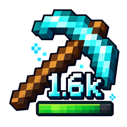

<div align="center">
  

  # Durability Indicator

  **Know exactly how much durability your gear has left.**

  A lightweight, customizable, client-side durability overlay for Minecraft.

  [](https://www.minecraft.net/)
  [](#compatibility)
  [](https://adoptium.net/)
  [](LICENSE)

  [**Releases**](https://github.com/Extraherz/Durability-Indicator/releases) · [**Report an Issue**](https://github.com/Extraherz/Durability-Indicator/issues) · [**Source Code**](https://github.com/Extraherz/Durability-Indicator)
</div>

---

## Overview

**Durability Indicator** displays the remaining durability directly on damageable item icons, so you can check your tools, weapons, and armor at a glance without hovering over every item.

The overlay is designed to feel at home in Minecraft's interface: it uses compact numbers, intuitive durability colors, and automatic positioning alongside the vanilla durability bar. Prefer a cleaner look? Customize the text or hide the vanilla bar entirely.

The mod runs **on the client only**. It does not need to be installed on a Minecraft server.

## Features

- **Durability at a glance** — see the actual remaining durability on damageable item icons, including in the hotbar and inventory.
- **Compact or exact values** — display `1,6k` instead of `1561`, or switch to the full number.
- **Five color tiers** — distinguish healthy equipment from items close to breaking; customize every color and its threshold.
- **Optional vanilla bar** — keep Minecraft's original durability bar (enabled by default) or hide it.
- **Adaptive text placement** — the overlay automatically changes position depending on whether the vanilla bar is visible, with separate adjustable offsets.
- **Adjustable appearance** — change text scale, horizontal/vertical offsets, and text shadow.
- **Creative Mode awareness** — undamaged items are hidden by default in Creative Mode, while previously damaged items still show their remaining durability. This behavior is configurable.
- **In-game configuration** — manage settings through a MidnightLib-powered screen, with English and German translations.
- **Multi-loader support** — separate builds for Fabric and NeoForge; the Fabric build can also be used with Quilt in a compatible setup.

### Default durability colors

| Remaining durability | Default color | Hex value |
| :--- | :--- | :--- |
| 75–100% | Green | `#55FF55` |
| 50–74% | Orange | `#FFAA00` |
| 25–49% | Yellow | `#FFFF55` |
| 5–24% | Red | `#FF5555` |
| 0–4% | Dark red | `#AA0000` |

All colors and the four upper-tier thresholds can be adjusted independently in the configuration screen.

## Compatibility

| Platform | Minecraft version | Requirements | Download |
| :--- | :--- | :--- | :--- |
| **Fabric** | 26.3 | Fabric Loader **0.19.5+**, Fabric API, MidnightLib **1.10.0+** | Fabric JAR |
| **Quilt** | 26.3 | Compatible Quilt Loader, Fabric API compatibility, MidnightLib (Fabric build) | **Fabric JAR** |
| **NeoForge** | 26.3 | NeoForge **26.3.0.76+**, MidnightLib **1.10.0+** | NeoForge JAR |

**Java 25** is required. Choose the JAR matching your mod loader; do **not** install both loader-specific versions together.

> **Quilt note:** Quilt uses the Fabric build. Compatibility depends on a Quilt environment capable of loading the required Fabric-based dependencies.

## Installation

1. Install **Minecraft 26.3** with your preferred supported mod loader.
2. Install the required dependencies for that loader:
   - **Fabric / Quilt:** [Fabric API](https://modrinth.com/mod/fabric-api) and [MidnightLib](https://modrinth.com/mod/midnightlib) (Fabric version).
   - **NeoForge:** [MidnightLib](https://modrinth.com/mod/midnightlib) (NeoForge version).
3. Download the matching Durability Indicator JAR from [GitHub Releases](https://github.com/Extraherz/Durability-Indicator/releases).
4. Place the mod JAR and its dependencies into your Minecraft instance's `mods` folder.
5. Launch Minecraft.

No server-side installation or world changes are necessary.

## Configuration

Durability Indicator uses **MidnightLib** for its in-game settings screen. Open the mod's configuration through your mod-management interface (for example, **Mod Menu** on Fabric) to customize the display.

Settings are also saved in `config/durabilityindicator.json` inside your Minecraft instance.

| Category | Available options | Default |
| :--- | :--- | :--- |
| **General** | Enable overlay | On |
| | Show undamaged items in Creative Mode | Off |
| **Display** | Text scale | `0.6` |
| | Compact numbers | On |
| | Text shadow | On |
| | Show vanilla durability bar | On |
| **Position** | Horizontal offset | `0` |
| | Vertical offset with bar / without bar | `0` / `0` |
| **Colors** | Green, orange, yellow, red, dark red | See [default colors](#default-durability-colors) |
| **Thresholds** | Green / orange / yellow / red | `75` / `50` / `25` / `5` % |

The default overlay position is optimized for both cases: **with** and **without** Minecraft's durability bar. Position settings are relative offsets, so leaving them at zero preserves the intended alignment.

## Building from source

This repository is a multi-module Gradle project with shared durability logic and loader-specific implementations.

**Requirements:** JDK 25 and Git. The Gradle wrapper is included; no separate Gradle installation is needed.

```bash
git clone https://github.com/Extraherz/Durability-Indicator.git
cd Durability-Indicator
./gradlew clean build
```

On Windows (PowerShell), run `.\gradlew.bat clean build` instead.

Build artifacts are placed in:

```text
fabric/build/libs/durabilityindicator-fabric-1.0.0.jar
neoforge/build/libs/durabilityindicator-neoforge-1.0.0.jar
```

Use the regular release JARs, not the `-sources` or development variants.

## Contributing and issues

Bug reports, compatibility feedback, and feature suggestions are welcome. Please use [GitHub Issues](https://github.com/Extraherz/Durability-Indicator/issues) and include your Minecraft version, mod loader, mod version, and reproduction steps when reporting a problem.

Pull requests are welcome as well. For larger changes, consider opening an issue first to discuss the approach.

**Future enhancements:** Unbreaking-aware estimates of remaining uses may be considered for a later release. Version 1.0.0 reports the item's actual remaining durability, not an estimated number of uses.

## License

Durability Indicator is developed by **Extraherz** and distributed under the [Apache License 2.0](LICENSE).
